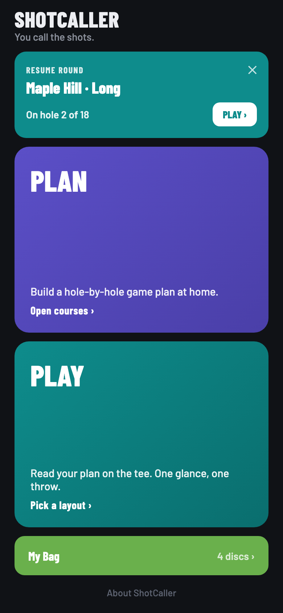
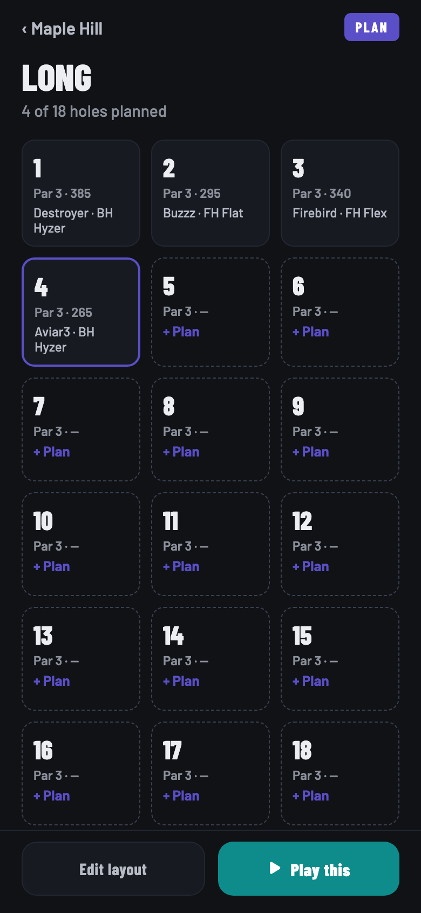
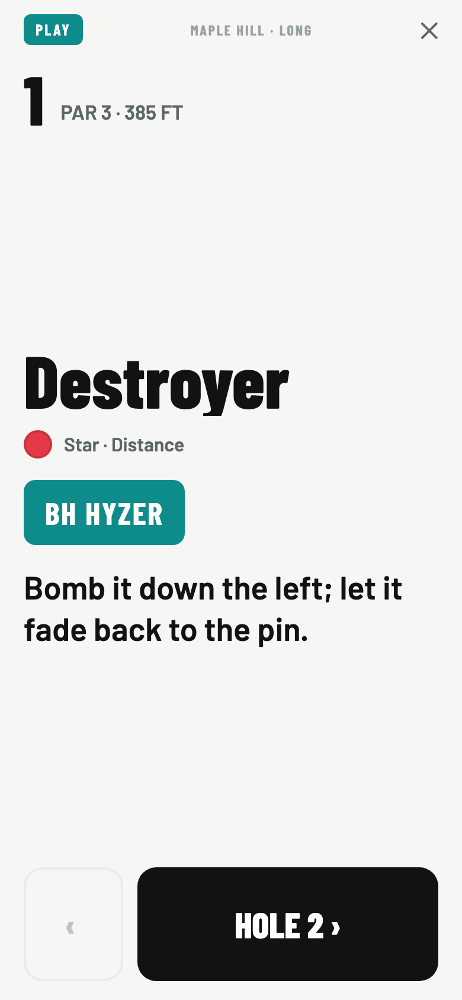
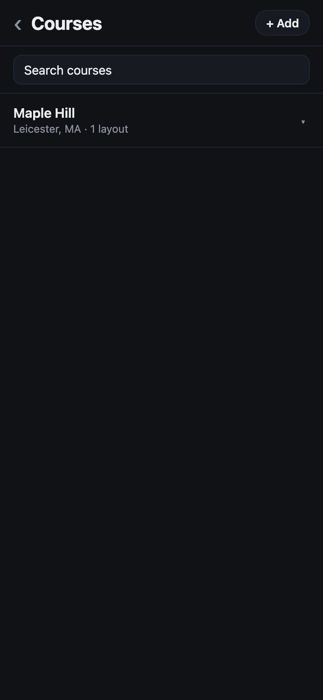
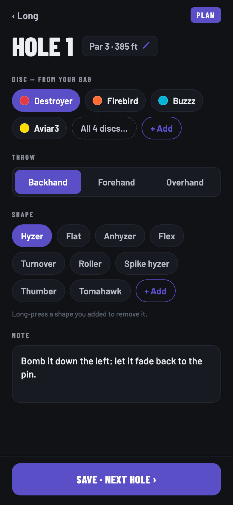
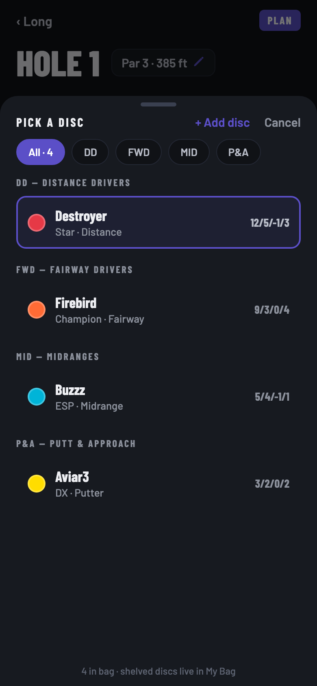
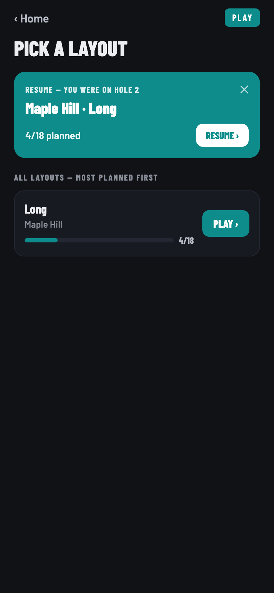
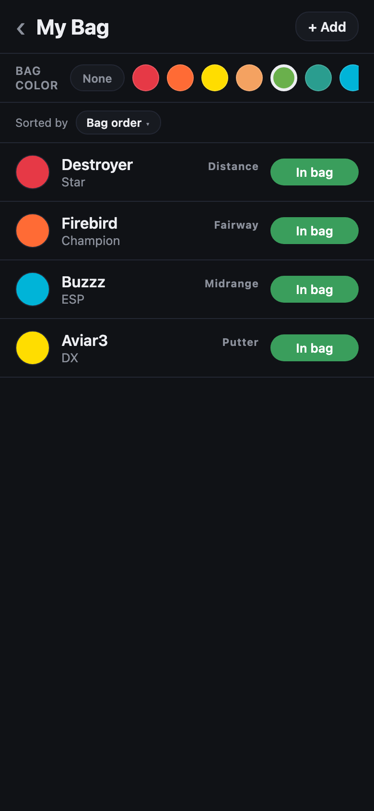
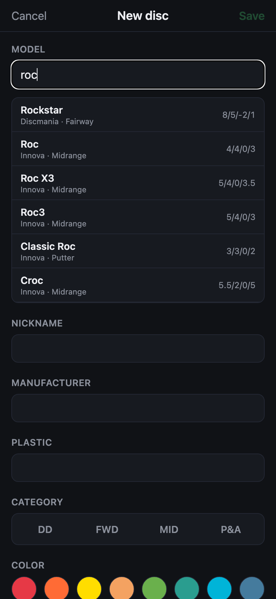
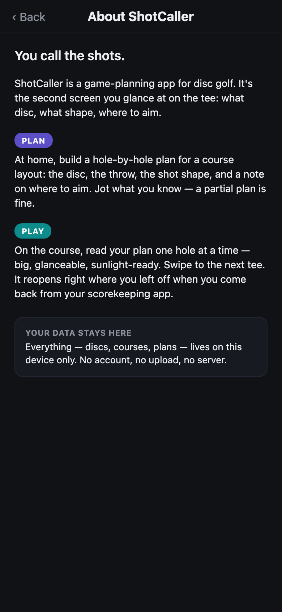

# ShotCaller

### *You call the shots.*

**ShotCaller is a game-planning app for disc golf.** You build a hole-by-hole
plan at home, then read it — big and glanceable — on the tee.

It's the **second screen** you keep next to your scorekeeping app (UDisc, PDGA).
It doesn't keep score. It answers the one question you have on every tee box:
*what am I throwing here, and where?*

---

## The gist

Serious players already plan their rounds — but they do it in the Notes app or a
spreadsheet. It's clunky, and it's not built for disc golf. ShotCaller is:

- **Two modes.** *Plan* at home (calm, thumbs and time to spare). *Play* on the
  course (one hand, sunlight, eight seconds before you throw).
- **Disc-golf native.** Real discs from your bag, real throws and shot shapes —
  not free-text notes.
- **Offline, on-device.** No account, no upload, no server. It just works on the
  course with no signal.

*(Screens below use mock data. Early prototype — feedback very welcome.)*

---

## The arc: home → plan → play

<table>
<tr>
<td width="33%"></td>
<td width="33%"></td>
<td width="33%"></td>
</tr>
<tr>
<td align="center"><em>Home — resume a round, or dive into Plan / Play. The bag tile even matches your real bag's color.</em></td>
<td align="center"><em>Every hole at a glance — what's planned, what's blank.</em></td>
<td align="center"><strong>The payoff:</strong> <em>on the tee, one glance = disc, shape, aim.</em></td>
</tr>
</table>

---

## 📝 Plan — build it at home

For each hole: pick the **disc**, the **throw**, the **shot shape**, and jot a
**note** on where to aim. Jot what you know — a partial plan is fine. Need a disc
or a shape that isn't there? Add it without leaving the flow.

<table>
<tr>
<td width="33%"></td>
<td width="33%"></td>
<td width="33%"></td>
</tr>
<tr>
<td align="center"><em>Your courses, each with multiple layouts.</em></td>
<td align="center"><em>Plan a hole: disc · throw · shape · note.</em></td>
<td align="center"><em>Pick from your bag, grouped by type, with flight numbers.</em></td>
</tr>
</table>

---

## ⛳ Play — read it on the tee

The caddie card (in the arc above) is the whole point: the disc name is the
biggest thing on screen, the shot shape reads as one phrase ("BH HYZER"), the aim
note sits right below — **sunlight-ready, one-handed, swipe to the next hole.** It
**reopens right where you left off** when you bounce back from your scorekeeping app.

<table>
<tr>
<td width="33%"></td>
<td width="66%"></td>
</tr>
<tr>
<td align="center"><em>Pick a layout to play — resume where you were, or start fresh. Coverage bars show how planned each layout is.</em></td>
<td></td>
</tr>
</table>

---

## 🎒 Your bag

Build your collection once. Type a disc name and it **autocompletes from a
1,000+ disc database** — flight numbers fill themselves in. Mark what's in the
bag; those are the discs you'll pick from while planning.

<table>
<tr>
<td width="33%"></td>
<td width="33%"></td>
<td width="33%"></td>
</tr>
<tr>
<td align="center"><em>Your bag — model, plastic, category, in-bag.</em></td>
<td align="center"><em>Add a disc: the catalog does the typing for you.</em></td>
<td></td>
</tr>
</table>

---

## How it fits

<table>
<tr>
<td width="33%"></td>
<td width="66%">

ShotCaller runs <strong>alongside</strong> UDisc or the PDGA app — they keep
score, ShotCaller tells you what to throw. Everything lives on your device;
there's no account and no server.

Built with React Native (Expo), so it runs on iOS and Android from one codebase.

</td>
</tr>
</table>

---

## What we'd love your take on

1. Would you actually use this **next to** your scorekeeping app during a round?
2. Is the **Plan → Play** loop clear and worth the setup effort?
3. On the tee, does the **caddie card** give you what you need in one glance?
4. What's the one thing that would have to exist before you'd bring it to a real round?

Thanks for taking a look — hit reply with anything, big or small.
