# ShotCaller

### *You call the shots.*

**ShotCaller is a game-planning app for disc golf.** You build a hole-by-hole
plan at home, then read it — big and glanceable — on the tee.

It's the **second screen** you keep next to your scorekeeping app (UDisc, PDGA).
It doesn't keep score. It answers the one question you have on every tee box:
*what am I throwing here, and where?*

**Try it:** <https://polaromonas.github.io/shotcaller/> · **Slides:** [`ShotCaller-deck.pdf`](./ShotCaller-deck.pdf)

---

## The gist

Serious players already plan their rounds — but they do it in the Notes app or a
spreadsheet. It's clunky, and it's not built for disc golf. ShotCaller is:

- **Two modes.** *Plan* at home (calm, thumbs and time to spare). *Play* on the
  course (one hand, sunlight, seconds before you throw).
- **Disc-golf native.** Real discs from your bag, real throws and shot shapes —
  not free-text notes.
- **On your phone only.** No account, no upload, no server.

*(Screens below use demo data: a fictional course, Cedar Ridge, and a realistic
15-disc bag. Early prototype — feedback very welcome.)*

---

## The arc: home → plan → play

<table>
<tr>
<td width="33%">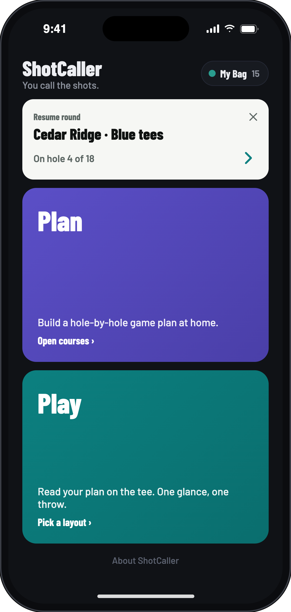</td>
<td width="33%">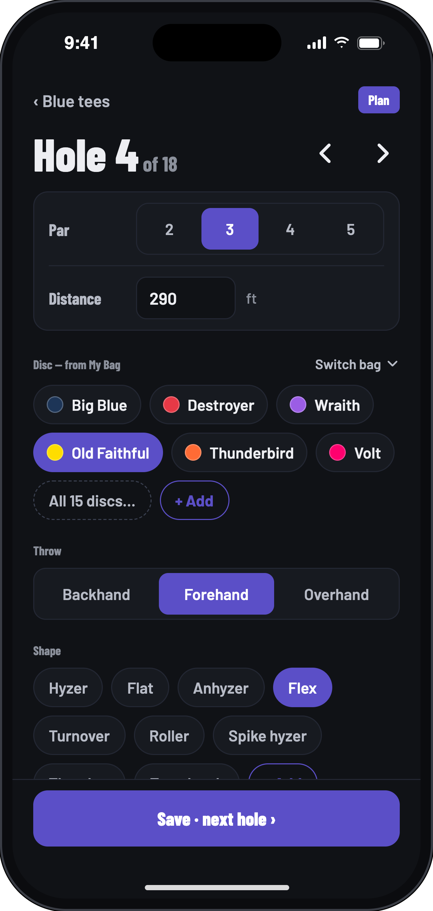</td>
<td width="33%">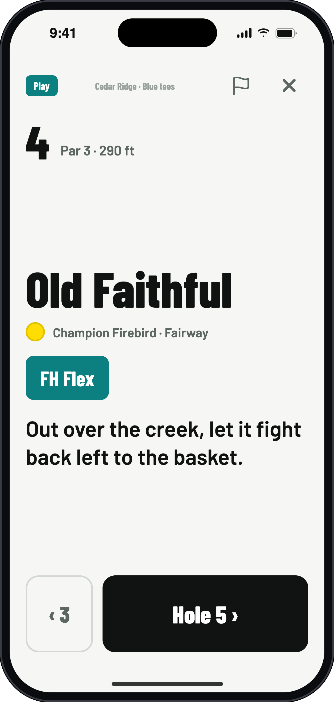</td>
</tr>
<tr>
<td align="center"><em>Home — resume a round, or open Plan / Play.</em></td>
<td align="center"><em>At home: disc, throw, shape, and where to aim.</em></td>
<td align="center"><strong>The payoff:</strong> <em>on the tee, one glance = disc, shape, aim.</em></td>
</tr>
</table>

---

## Plan — build it at home

For each hole: pick the **disc**, the **throw**, the **shot shape**, and jot a
**note** on where to aim. Partial plans are fine — jot what you know. Page between
holes with ‹ ›; every hole saves as you leave it. Need a disc or a shape that isn't
there? Add it without leaving the flow. Layouts can have any number of holes.

Keep **several bags** — main, glow, winter, travel. A disc can be in more than one;
pick the bag you're carrying and Plan only offers its discs.

<table>
<tr>
<td width="33%">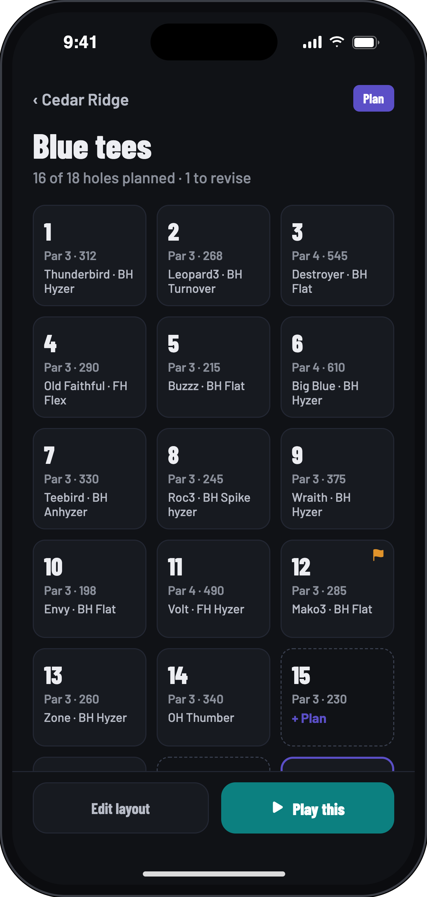</td>
<td width="33%">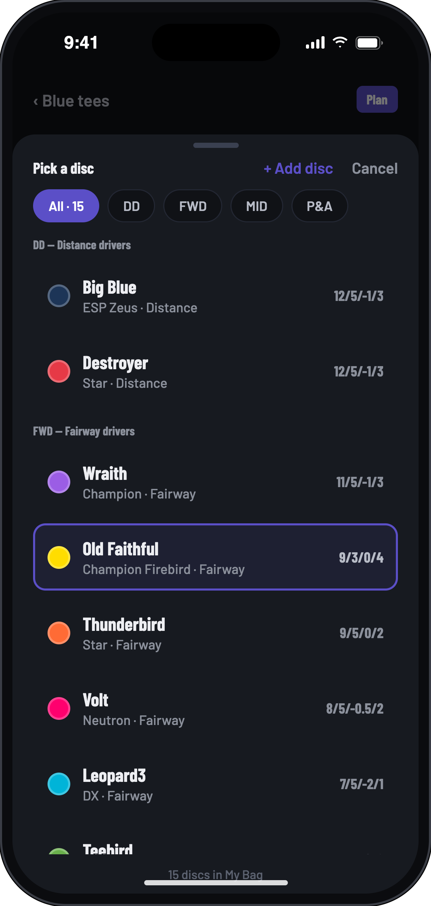</td>
<td width="33%">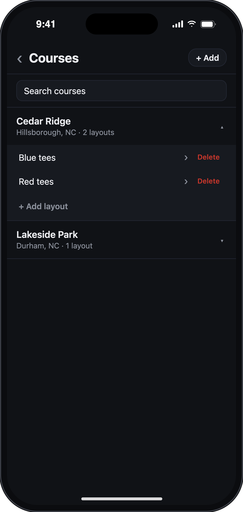</td>
</tr>
<tr>
<td align="center"><em>Every hole at a glance — planned, blank, or flagged.</em></td>
<td align="center"><em>Pick from your bag, grouped by type, with flight numbers.</em></td>
<td align="center"><em>Courses with multiple layouts (Blue tees, Red tees).</em></td>
</tr>
</table>

---

## Play — read it on the tee

The disc name is the biggest thing on screen, the throw and shape read as one
phrase ("FH Flex"), and the aim note sits right below — **high contrast for
sunlight, one-handed, swipe to the next hole.** It **reopens where you left off**
when you come back from your scorekeeping app.

<table>
<tr>
<td width="33%">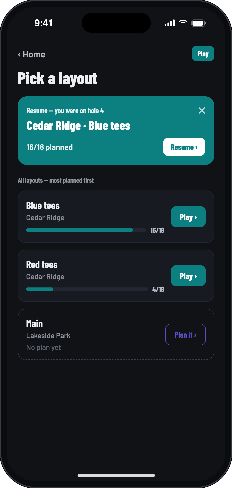</td>
<td width="33%">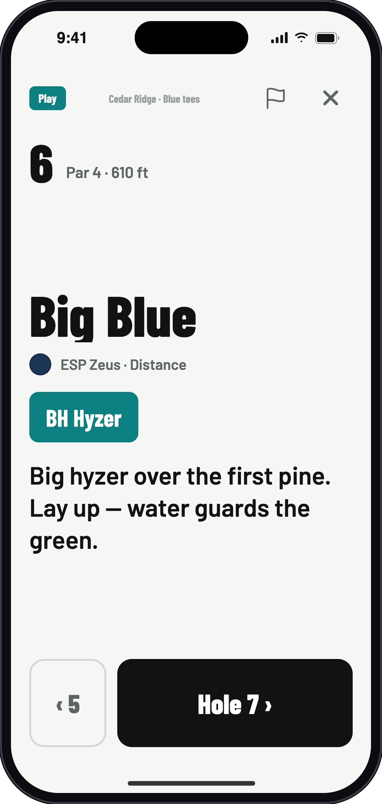</td>
<td width="33%">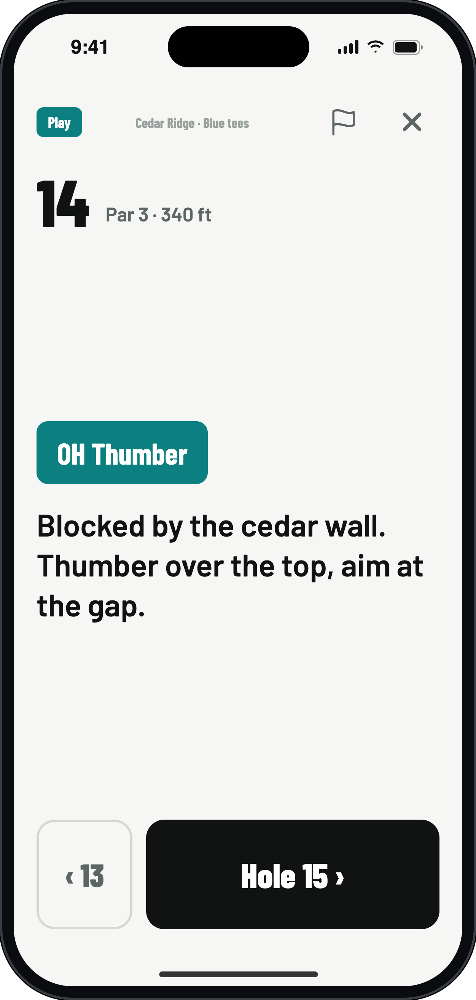</td>
</tr>
<tr>
<td align="center"><em>Pick a layout — or resume the round you're in.</em></td>
<td align="center"><em>A par 4: plan the drive, note the layup.</em></td>
<td align="center"><em>Overhands too — a Thumber locks the throw to Overhand.</em></td>
</tr>
</table>

---

## Flag it on the course, fix it at home

A plan didn't work? One tap on the tee flags it, with an optional quick note on
what to change. Back home, the layout shows "1 to revise" and the hole opens with
your note pinned above the save button while you fix it.

<table>
<tr>
<td width="33%">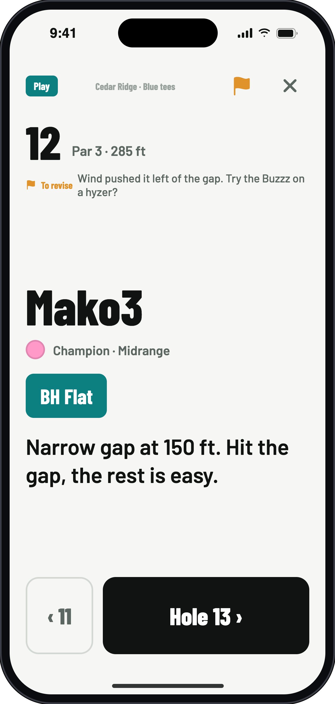</td>
<td width="33%">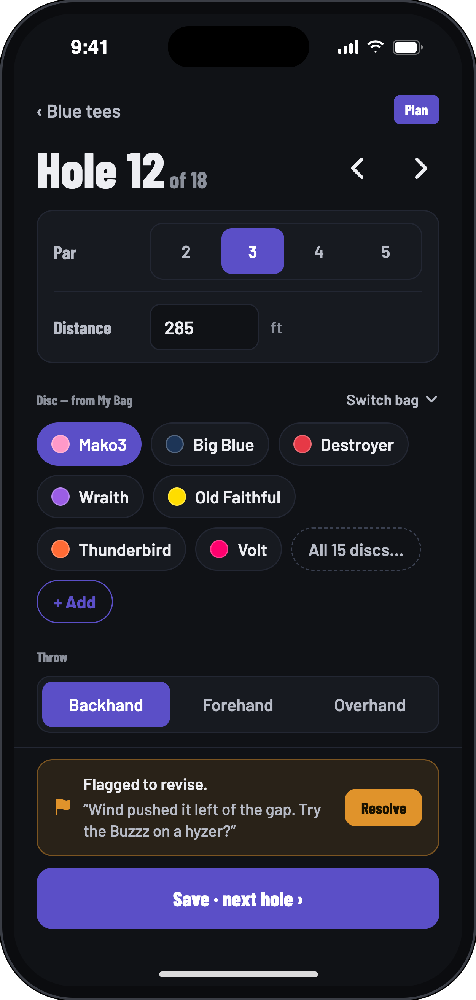</td>
<td width="33%">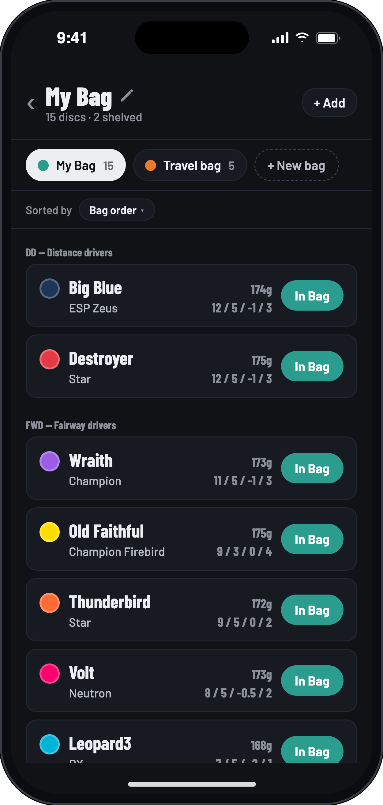</td>
</tr>
<tr>
<td align="center"><em>On the tee: flag it, say what to change.</em></td>
<td align="center"><em>At home: your note stays in view; fix it, then resolve.</em></td>
<td align="center"><em>My Bag — several bags; type a mold and ~1,200 catalog discs fill in the flight numbers.</em></td>
</tr>
</table>

---

## Coming next

- **Tee photo + aim line** — snap the tee pad and draw your line on it.
- **Plan B** — a backup for when conditions change ("if headwind, FH roller").

---

## What we'd love your take on

1. Would you actually use this **next to** your scorekeeping app during a round?
2. Is the **Plan → Play** loop clear and worth the setup effort?
3. On the tee, does the **caddie card** give you what you need in one glance?
4. What's the one thing that would have to exist before you'd bring it to a real round?
5. Of the two **coming next** features, which would you want first?

Thanks for taking a look — hit reply with anything, big or small.

---

Regenerate: start `npx expo start --web --port 8091`, then
`node scripts/capture-screens.mjs && node scripts/build-deck.mjs`.
`screens/` has the plain screenshots, `framed/` the phone mockups, `slides/` each slide as a PNG.
`node scripts/build-deck.mjs pitch` builds just this deck.
